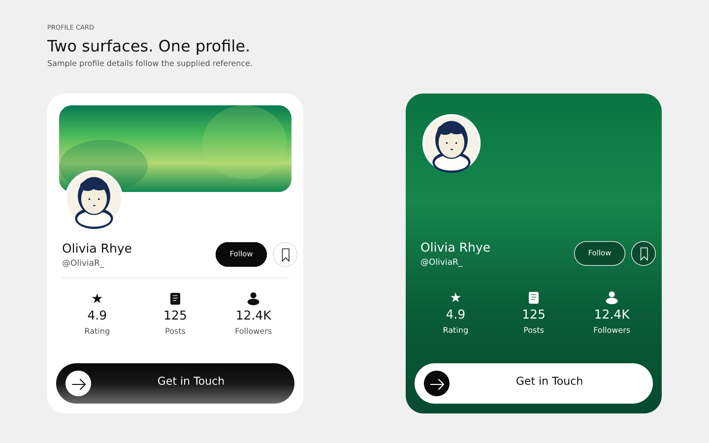
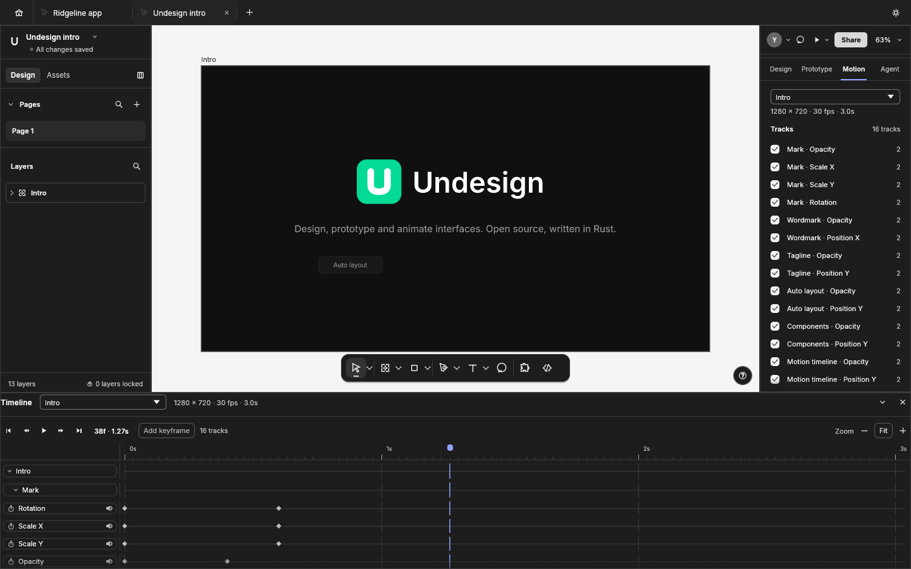
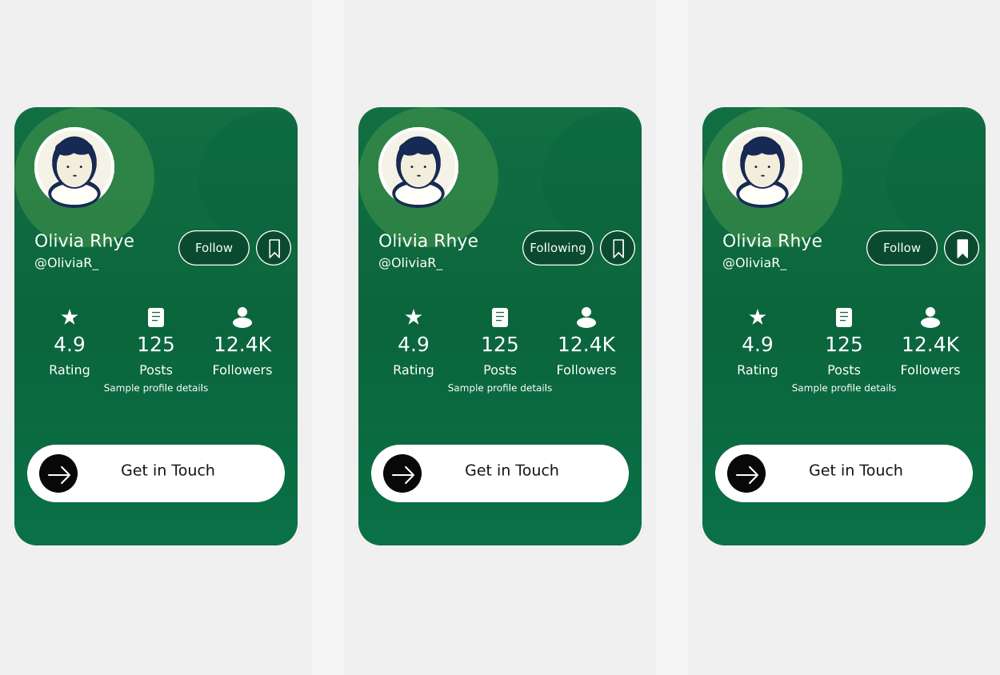

<p align="center">
  
</p>

<h1 align="center">Undesign</h1>

<p align="center">
  <b>An open-source interface design and prototyping app, written in Rust.</b><br>
  This repository includes a browser-based showcase of sample files and editor workflows.<br>
  Explore the demo first; treat the app as an early alpha, not a finished production tool.
</p>

<p align="center">
  
  
  
  
</p>

<br>

<p align="center">
  
  <br><sub><b>Profile card design</b>: two editable treatments based on the supplied reference · <code>examples/profile-card-design.undesign</code></sub>
</p>

<p align="center">
  <b>Open a ready-to-explore sample in your browser:</b><br>
  <a href="https://palcchi.github.io/undesign/?example=undesign-intro"><b>▶ Motion demo</b></a> (plays the Undesign intro sample) ·
  <a href="https://palcchi.github.io/undesign/?example=profile-card-design"><b>Design demo</b></a> ·
  <a href="https://palcchi.github.io/undesign/?example=profile-card-prototype"><b>Prototype demo</b></a> ·
  <a href="prototype/profile-card/"><b>Standalone web prototype source</b></a> ·
  <a href="https://palcchi.github.io/undesign/">open the app</a> (choose any sample from Home ▸ Examples)
</p>
<p align="center"><sub>The profile-card browser links work once this branch is included in the published web build; the source files are available above and in <code>examples/</code>.</sub></p>

<br>

<p align="center">
  <a href="#a-look-around">Screens and workflows</a> ·
  <a href="#examples">Browser examples</a> ·
  <a href="#made-in-undesign">Sample artwork</a> ·
  <a href="#features">What you can try</a> ·
  <a href="#scriptable-to-the-core">Automation</a> ·
  <a href="#under-the-hood">Implementation</a> ·
  <a href="#get-started">Build it</a>
</p>

<br>

<p>The profile-card sample is an editable interpretation of the supplied reference; its name and statistics are illustrative sample content. The standalone HTML version is a separate, responsive page with working Follow and save controls and an on-page contact preview.</p>

<table>
  <tr>
    <td width="25%" valign="top">
      <h3>Design in one workspace</h3>
      Work with frames, layers, reusable components, styles, variables and vector shapes in a native interface.
    </td>
    <td width="25%" valign="top">
      <h3>Rust-powered editor</h3>
      A persistent document model lets edits focus on changed data. The desktop app uses egui rather than Electron or an embedded web view.
    </td>
    <td width="25%" valign="top">
      <h3>Local files by default</h3>
      Projects are <code>.undesign</code> files on your device. The app has no account or telemetry; online sharing is optional and described in <a href="#privacy-and-online-sharing">the privacy notes</a>.
    </td>
    <td width="25%" valign="top">
      <h3>Same engine, several ways</h3>
      Use the interface, command-line tools or JSON control channel to work with the document model.
    </td>
  </tr>
</table>

<br>

## A look around

<p>The retained motion sample and the new three-state profile prototype show two of the workflows available in the app.</p>

<table>
<tr>
<td width="50%" valign="top">
  
  <p align="center"><sub><b>Motion workspace</b>: preview an animated intro with property tracks and keyframes · <code>examples/undesign-intro.undesign</code></sub></p>
</td>
<td width="50%" valign="top">
  
  <p align="center"><sub><b>Prototype flow</b>: Follow and save transitions connect three profile states · <code>examples/profile-card-prototype.undesign</code></sub></p>
</td>
</tr>
</table>

## Examples

Each built-in example opens as a fresh copy; edits do not replace the bundled original. Motion examples open in the Motion workspace and start playing. The files are also listed in [`examples/`](examples). The new profile-card browser links need a public web build that includes this branch.

| Sample file | Demo focus | Open in browser |
|---|---|---|
| [Undesign intro](examples/undesign-intro.undesign) | Animated logo and feature labels, arranged on a three-second timeline with 16 eased tracks | [Try the motion demo](https://palcchi.github.io/undesign/?example=undesign-intro) |
| [Daybreak motion study](examples/daybreak-motion-study.undesign) | Weather-screen composition with translucent panels, a sun and forecast animation | [Try the motion demo](https://palcchi.github.io/undesign/?example=daybreak-motion-study) |
| [Profile card design](examples/profile-card-design.undesign) | Two editable creator-profile treatments, with white and green surfaces based on the supplied reference | [Try the Design demo](https://palcchi.github.io/undesign/?example=profile-card-design) |
| [Profile card prototype](examples/profile-card-prototype.undesign) | Three linked profile states; Follow and save actions move between them | [Try the Prototype demo](https://palcchi.github.io/undesign/?example=profile-card-prototype) |

The separate responsive website prototype is in [`prototype/profile-card/`](prototype/profile-card/). Its Follow and save controls toggle state; Get in Touch opens a local preview rather than sending a message.

## Made in Undesign

The Profile card Design file is built from editable frames, text and vector shapes. The Prototype file connects three states through Follow and save interactions. Both use illustrative sample content and are available as `.undesign` files in [`examples/`](examples); the static website version is in [`prototype/profile-card/`](prototype/profile-card/).

## Features

The browser demo gives you a guided look at the editor. In the desktop app and web build, the current feature set includes:

<table>
  <tr>
    <td width="50%" valign="top">
      <h3>Layout and reusable design</h3>
      Build with auto layout, wrapping and grids; adjust spacing, sizing and constraints on the canvas. Create components and variants, then share local styles and colour, number, string or boolean variables across a file.
    </td>
    <td width="50%" valign="top">
      <h3>Vector, paint and type</h3>
      Draw and edit vector networks, combine editable shapes, and style them with gradients, images, blur, masks and other effects. Text supports mixed formatting, variable fonts, text styles, right-to-left scripts and system fonts.
    </td>
  </tr>
  <tr>
    <td width="50%" valign="top">
      <h3>Prototype and hand off</h3>
      Connect screens with triggers and transitions, use variables in interactions, preview flows, inspect measurements and annotations, and export layers as PNG, JPG, WebP, SVG or PDF. Handoff tools include a ready-for-dev list, change comparison and code views for CSS, HTML, React, Leptos, SwiftUI and Compose.
    </td>
    <td width="50%" valign="top">
      <h3>Motion</h3>
      Arrange position, scale, rotation, opacity and size tracks on a shared timeline. Set keyframes, adjust timing and preview playback on the canvas. This is an early feature slice; a graph editor and video export are not included yet.
    </td>
  </tr>
  <tr>
    <td width="50%" valign="top">
      <h3>Optional AI Agent</h3>
      On desktop, connect your own OpenAI-compatible endpoint or Anthropic Messages API; its key stays in memory for the session and no request is sent until you press Send. The browser demo instead connects to a shared relay, so no key is needed. The Agent reads the current page and applies nothing until you approve the proposal.
    </td>
    <td width="50%" valign="top">
      <h3>Use your preferred workflow</h3>
      The same commands power the graphical interface, command-line tools, scripts and JSON control channel. Local design work does not require an account or a network connection.
    </td>
  </tr>
  <tr>
    <td colspan="2" valign="top">
      <h3>Comment, chat and share</h3>
      Pin comments to any layer and jump to their target from the thread. Keep a group chat in the file itself, with mentions and a composer in the Chat history; ask the Agent from chat with /agent and its answer lands as an anchored thread. Invite collaborators to a live session with shared cursors and per-person undo.
    </td>
  </tr>
</table>

<br>

## Scriptable to the core

Undesign routes interface actions through a shared command registry of 400+ operations. That lets the desktop UI, CLI and JSON control channel work against the same document model.

```sh
# Render a document without opening the editor
undesign-cli render landing.undesign -o landing.png --scale 2
undesign-cli export landing.undesign -o out/ --format svg

# Apply a command script and save the result
undesign-cli run build-card.json --out card.undesign

# Find commands and their parameters
undesign-cli commands --filter autoLayout
```

The desktop build also has a loopback-only control channel for reading UI state, sending pointer or key events, and capturing screenshots. See [`docs/control-protocol.md`](docs/control-protocol.md) and [`docs/cli.md`](docs/cli.md).

## Under the hood

- **Document engine:** a data-focused model and command layer sit beneath a replaceable egui interface; workspace layering is checked by `cargo xtask layers`.
- **Incremental updates:** an immutable ordered map makes undo snapshots inexpensive and limits layout, component sync and text measurement to changed data.
- **Rendering and text:** tiny-skia draws the canvas and exports; geometry, booleans and text use Rust libraries including kurbo, linesweeper, skrifa and HarfRust.
- **Browser build:** the engine and interface compile to WebAssembly.
- **Accessibility:** tools and controls expose names, roles and states to assistive technology; keyboard navigation, reduced-motion preferences and contrast are supported.
- **Localization:** English, Russian and Turkish have native-speaker review; additional language drafts include Indonesian. Translation catalogs are documented in [`docs/translating.md`](docs/translating.md).
- **Plugins:** sandboxed WebAssembly extensions run through the command layer with manifest permissions. The SDK and examples are in [`plugins/`](plugins); see [`docs/plugins.md`](docs/plugins.md).
- **Live collaboration (preview):** invite collaborators to edit a shared file with synchronized changes, cursors and per-person undo. Review the connection and storage details in [`docs/collab-protocol.md`](docs/collab-protocol.md).
- **Clean-room implementation:** the project is based on public documentation and observed behaviour, not copied proprietary source or file formats.

## Get started

Build and test the desktop app with Rust:

```sh
git clone https://github.com/palcchi/undesign
cd undesign
cargo run --release -p undesign            # launch the desktop editor
cargo test --workspace                     # run the test suite
cargo xtask ci                             # formatting, lint, tests and checks
```

The UI and Text tool use fonts from [craft-fonts](https://github.com/storytold/craft-fonts), expected beside this repository at `../craft-fonts`. If they are absent, system fonts are used instead.

```sh
git clone https://github.com/storytold/craft-fonts ../craft-fonts
```

After adding the fonts to an already-built checkout, run `cargo clean -p undesign-text` before rebuilding so they are embedded.

Eight starter templates are generated by the app from synthetic content, including mobile, landing-page, dashboard, design-system, wireframe, announcement, presentation and icon-set starters. The web target can be built with [trunk](https://trunkrs.dev/) and `cargo xtask wasm`.

If you plan to contribute, read [`AGENTS.md`](AGENTS.md) and the material in [`docs/`](docs/) first. Installers for macOS, Windows, Linux, FreeBSD and web builds are attached to each [GitHub release](https://github.com/palcchi/undesign/releases); release steps are in [`docs/releasing.md`](docs/releasing.md).

> [!IMPORTANT]
> **Project status:** Undesign is an early alpha. Core editing workflows are implemented, but the browser links on this page are demonstrations built around sample files, not a guarantee of production readiness. `.fig` import is best-effort; live collaboration is a preview, with no accounts, teams or hosted cloud workspace; and the project has not been validated against real-world design documents. Check the [roadmap](ROADMAP.md), [`docs/parity-checklist.md`](docs/parity-checklist.md) and [`docs/target-app-parity.md`](docs/target-app-parity.md) for the current scope, and expect rough edges.

## Privacy and online sharing

The app can be used offline without an account or telemetry. It makes network requests when you join or share a file. Live collaboration is experimental, so understand the trade-offs before using it for anything sensitive:

- **Online sharing sends the document to a server.** Undesign does not ship its own hosted server; you configure a compatible server in Preferences. The file remains there after a session ends until it is removed with Share ▸ Advanced ▸ Remove from server…
- **Server-side files are not end-to-end encrypted.** TLS protects the connection, but the server stores readable file contents. Use a server you trust, or choose local-network sharing instead.
- **Invite codes grant access.** There are no accounts. Anyone holding an edit code or link can edit; a view code or link allows viewing. Stopping the session revokes access and disconnects others.
- **Local-network sharing avoids a server but is not encrypted.** The host app serves the session directly, so only use it on networks you trust.
- **Agent requests send data to a provider.** A turn sends your prompt plus the current page context. On desktop the provider is yours; the browser demo uses a shared relay within fixed quotas, which forwards requests and keeps only quota counters — prompts, documents and comments are never stored.
- **Keep a separate copy.** The project makes no guarantee against loss; save your own copy before sharing.

---

## License and credits

You may use Undesign under either the [MIT](LICENSE-MIT) or [Apache-2.0](LICENSE-APACHE) license. See [NOTICE](NOTICE) for required notices.

Undesign builds on the open-source FigCraft editor ([brydanforge/figcraft](https://github.com/brydanforge/figcraft), MIT OR Apache-2.0, © 2026 ArtCraft Team and FigCraft contributors). Changes made locally against the imported upstream revision are listed in [`UNDESIGN-CHANGES.md`](UNDESIGN-CHANGES.md).

The inherited UI glyph set is code-drawn and adapted from FigCraft. The U logo and app icon are original project artwork. With project-owner approval, the code also includes monochrome copies of eight common Figma editor toolbar glyphs based on the public Help Center toolbar reference; their licence is unconfirmed, so no CC BY 4.0 claim is made. The screenshot is not included. See [ATTRIBUTION.md](ATTRIBUTION.md) for details. Bundled fonts, images and other assets retain their applicable licences, authors and source notes.

## Star history

[](https://www.star-history.com/?repos=palcchi%2Fundesign&type=date&legend=top-left)
